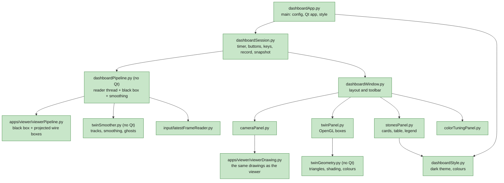
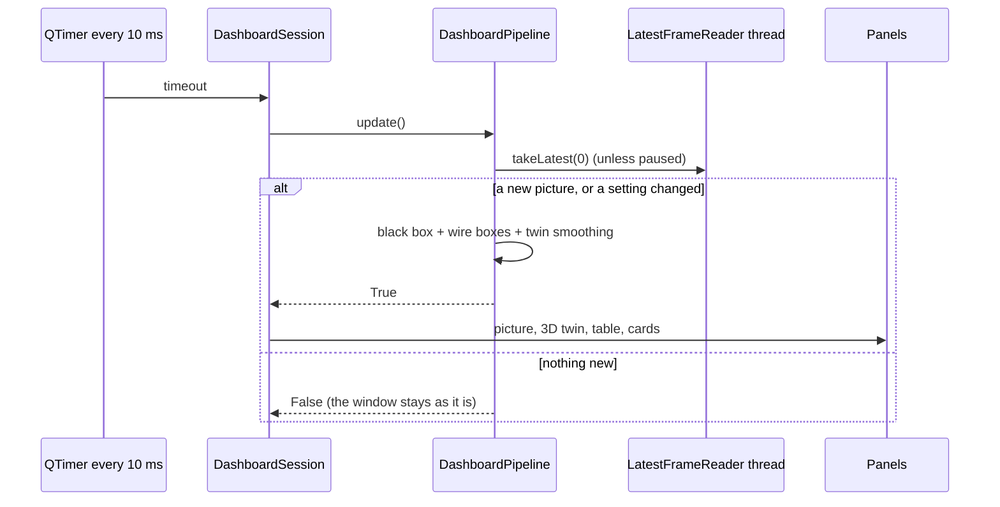

# How the dashboard and the viewer work

Two tools to see what the vision finds. Neither runs on the robot.

| | `apps/dashboard/` | `apps/viewer/` |
|---|---|---|
| Made with | Qt (PySide6) + pyqtgraph, OpenGL for the 3D | OpenCV windows only |
| Shows | Picture with detections, **3D twin**, stone table, status cards, colour tuning | Picture with detections and a status bar |
| Needs | `requirements-dashboard.txt`; on Ubuntu X11, once `sudo apt install libxcb-cursor0` | Nothing more than the robot code |
| Use it | To understand, demo and tune | Where Qt is not installed (a Jetson with a screen) |

Both use the same drawings (`apps/viewer/arucoOverlay.py`, `colorOverlay.py`, `poseOverlay.py`) and the same keys.

> Checked against the code on 2026-11-23.

## 1. The dashboard window

```text
┌ toolbar: Detectors ArUco | Colour | Both · Pause · Step · View · Rejected · Record · Snapshot · Fit ┐
│ camera with the detections (zoom: wheel)    │ legend · 3D twin (drag: turn · wheel: zoom)          │
├─────────────────────────────────────────────┴──────────────────────────────────────────────────────┤
│ cards: images/s · process ms · ArUco ms · colour ms │ Cardboard colour (HSV)                        │
│        stones · robot receives · calibration · mount│ six sliders · Pick on image · Reset · Save   │
│ table: # · source · x · y · yaw · level · confidence│                                               │
└ status bar: messages and keys ──────────────────────────────────────────────────────────────────────┘
```

- **Camera:** the picture with the codes (green, corner 0 in magenta), the colour blobs (orange), and each stone as a **wire box** drawn back on the picture from its 3D pose. If the wire box sits on the real stone, the pose, the calibration and the camera mount are right.
- **3D twin:** the floor in front of the robot (100 mm grid), the robot and its x (red), y (green), z (blue) arrows, the camera cone, and each stone as a box with its labels and codes. Colour = who found it: green ArUco, orange colour only, cyan both; grey = lost a moment ago (ghost); yellow edges = selected in the table.
- **Cards:** speed, time of each detector, how many stones, what the robot would receive (`OK` or `NOT_CALIBRATED`), calibration and mount.
- **Colour:** the HSV range of the cardboard. "Pick on image" (P) then a click on a stone measures it; "Save to config" writes it into the JSON file in use (only the `color` section changes).

| Key | Action | Key | Action |
|---|---|---|---|
| `1` `2` `3` | ArUco, colour, both | `X` | Rejected candidates and why |
| `Space` / `N` | Pause / next picture | `R` / `S` | Record raw video / snapshot |
| `M` / `T` | Colour mask / ArUco threshold view | `F` | Fit both views |
| `P` | Pick the colour with a click | `Q` | Quit |

## 2. Files and who uses whom

No Qt class is subclassed (team rule): every window part is built from Qt widgets and connected with Qt's own signals.



## 3. One turn of the dashboard



A recorded video plays at `viewer.playbackFramesPerSecond`; a camera or a stream as fast as it comes, always the newest picture.

## 4. The twin is smoothed, the robot data is not

`twinSmoother.py` pairs each stone with the nearest box of the last picture (a track with a number), mixes the old and the new position (`viewer.twinSmoothing`), and keeps a lost stone as a grey ghost for `viewer.twinGhostSeconds`.

Rotations: a box looks the same turned 180 degrees about any of its axes, or 90 degrees about its long side (its ends are square): 8 look-alike rotations. The new rotation is first turned to the look-alike closest to the old one, then mixed, and the mix is made a rotation again (SVD). Without this, a box seen with a yaw of 10 and then 190 degrees (the same box) would spin half a turn on the screen.

**This is only for the screen.** The robot receives the raw stones of each picture, with their capture time: smoothing there would add delay the robot cannot see.

## 5. The OpenCV viewer (`apps/viewer/`)

Updated in phase 3: it runs the black box (`viewerPipeline.py`), draws the colour blobs and the wire boxes, shows the mask view (`m`), and its status bar now says the time of each detector, the stones and the result status. The rest (keys, recording, snapshots) is as in phase 2a.

## 6. How it was checked

- `tests/vision/apps/dashboard/`: the smoothing, the triangles of the boxes and the dashboard pipeline (reading, refresh on a change of mode while paused), without a screen.
- On a real X11 screen, a script drove the window (mode change, mask view, pick a colour with a click, save it, rejected view, table selection, snapshot) and saved a picture of the window after each step.
- With the synthetic demo: 30 pictures/s shown, about 11 ms of processing per picture.
