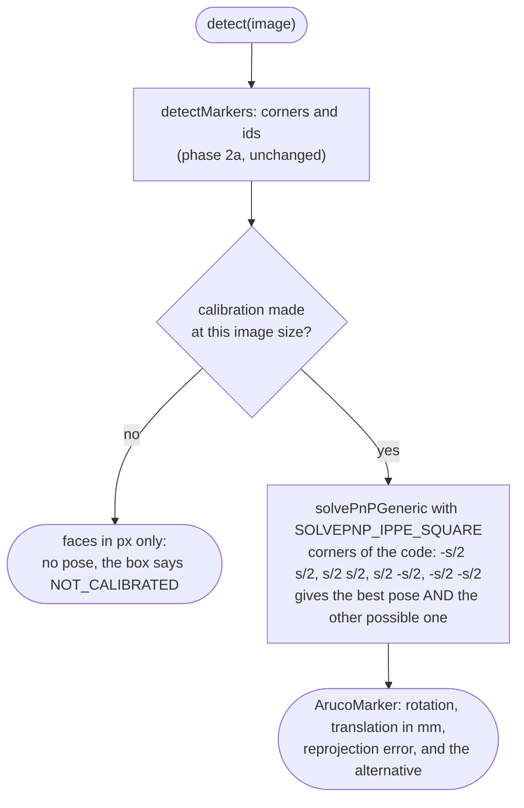
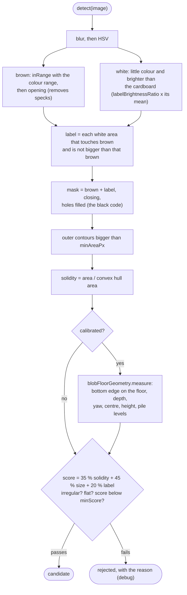
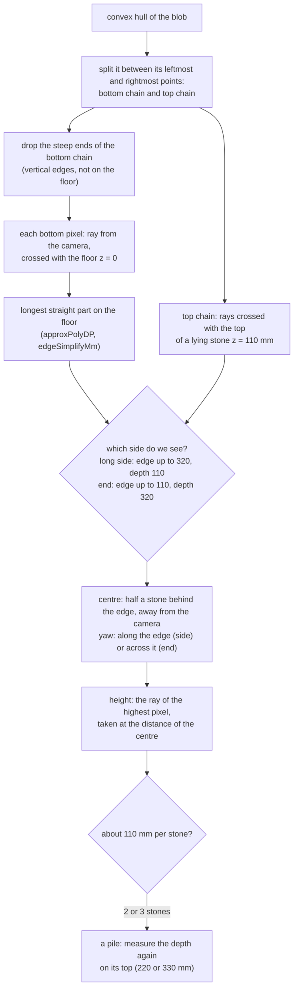

# How the two detectors work

`aruco/arucoStoneDetector.py` (main detector) and `color/` (support detector, for when the code cannot be read).
They do not know each other: only `fusion/` puts them together (`howFusionWorks.md`).

> Checked against the code on 2026-11-23. Numbers measured on synthetic scenes (`simulation/`), 640 x 480, 70 degrees wide, camera 300 mm high looking 30 degrees down.

## 1. The frames

```text
 Camera (OpenCV)        Robot                           Box (a stone)
   z forward              z up                            x along the 320 mm side
   x right                x forward                       y, z along the 110 mm sides
   y down                 y left                          origin at its centre
                          origin on the floor under the robot
```

`geometry/poseTransforms.py` turns camera into robot: first a fixed swap of axes (a level camera looking forward has its z on the robot x, its x on the robot -y and its y on the robot -z), then the mount angles of `cameraMount`: roll about the lens, pitch (positive looks down), yaw (positive turns left), and the mount position. A test checks it by hand: 300 mm high, 30 degrees down, the centre of the picture hits the floor 300 / tan(30) = 519.6 mm ahead.

## 2. ArUco: from the code to the stone



The detector stops at the code (camera frame). The fusion turns a code into a box, because it is the one that knows the camera mount:

- **Centre of the box**: the code lies on a large face and its z axis points out of the box, so the centre is 55 mm (half the width) behind the centre of the code, along the face normal.
- **The long side**: in Figure 5 of the rules the x axis of the code runs along the 320 mm side on every face (`aruco.markerLongAxis = "x"`, checked by detecting the 4 codes of that picture).
- **Snapping**: a stone rests on something, so one of its axes is vertical. The nearest axis is snapped to vertical before computing the yaw, and the centre uses the snapped normal (a code seen from the side has a poor normal, and 55 mm times that error adds up).

### The two poses of a square

A small flat square can be explained by two poses, tilted one way or the other. IPPE gives both with their reprojection errors. When the errors are close (ratio above `fusion.ambiguityErrorRatio`, 0.25) and the two face normals differ by more than `ambiguityMinAngleDeg`, **the physics decides**: the stone is not tilted and its centre is at 55, 165 or 275 mm (lying, levels 0 to 2) or 160 mm (standing). Each pose gets a cost, tilt in degrees + height error / 10, and the cheaper one wins.

Found while testing: on a side face seen at an angle, the **wrong** pose had the **smaller** error (0.20 against 0.41 px): it put the stone 24 degrees tilted and floating at 155 mm. Choosing by error alone fails there; the physics gets it right (test `testSideFaceSeenAtAnAngleIsNotTiltedNorFloating`).

### Measured

| Case | Error of the centre | Yaw error |
|---|---|---|
| 550-800 mm, code 40-70 px wide | under 15 mm (median 5 mm on 45 scenes) | under 3 degrees |
| 1.2 m, code about 20 px | under 30 mm | under 3 degrees |
| 1.5 m | under 40 mm | under 3 degrees |
| JPEG 70, blur, noise and a lens with distortion (k1 -0.25) | under 15 mm | under 3 degrees |

**Limits found** (they matter for where the camera goes):

- At 640 x 480 a code seen at an angle is lost at about 1 m: its picture is 12-16 px. At 1280 x 720 the range roughly doubles.
- A camera 300 mm high looking 30 degrees down **does not see the code of the third stone of a quarry** (it is above the top edge of the picture). Looking 10-20 degrees down, it does.

## 3. Colour + shape

`color/colorShapeDetector.py` finds the blobs; `color/blobFloorGeometry.py` measures them on the floor.



**Why the label matters:** the white label covers almost the whole height of a face (104 of 110 mm), so without it a face splits into two brown halves, each about 120 mm long, that look like the end of a stone. The first version had exactly that bug (median error 145 mm, yaw wrong by 90 degrees).

**Why the threshold of white is relative:** with a 30 % darker room the label fell below a fixed brightness and the faces split again. "Whiter than the cardboard around it" follows the light of the room.

### Where a blob stands: the floor-contact edge

A blob has no depth, but a stone rests on the floor: the bottom of its outline touches z = 0.



- **Flat things are not stones:** a brown rectangle painted on the floor, the size of a stone, measures about 40 mm of height and is rejected ("flat: no height").
- **Hidden parts:** a shorter edge than expected costs little (part of it may be covered), a longer one costs a lot.

### Measured (72 scenes: 3 distances, 3 sides, 4 yaws, code visible or covered)

| Case | Found | Centre error (median) | Yaw error (median) |
|---|---|---|---|
| Whole stone, light x1.0 | 36 of 36 | 8 mm (90 % under 14 mm) | 1 degree |
| Whole stone, light x0.55 / x0.7 / x1.3 | 36 / 36 / 35 of 36 | 7-8 mm | 1 degree |
| Code covered (the cover splits the face) | 27-33 of 36 | about 90 mm, along the stone | 1-2 degrees |

With part of the stone covered, the centre moves along the stone: the hidden part could be anywhere. The fusion joins two pieces of the same stone (`howFusionWorks.md`) and gives colour stones a low confidence.

**Known limits** (written in the code too): two stones that touch in the picture make one blob (rejected); a stone touching a brown zone of the mat joins it; a stone lifted from the floor (in the gripper) is placed wrong by colour, but the ArUco is the main detector. The brown of the official mat and the real light must be measured on the table: the dashboard does it with a click.
