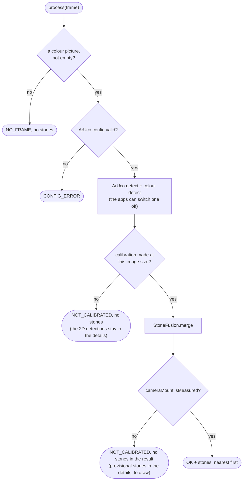
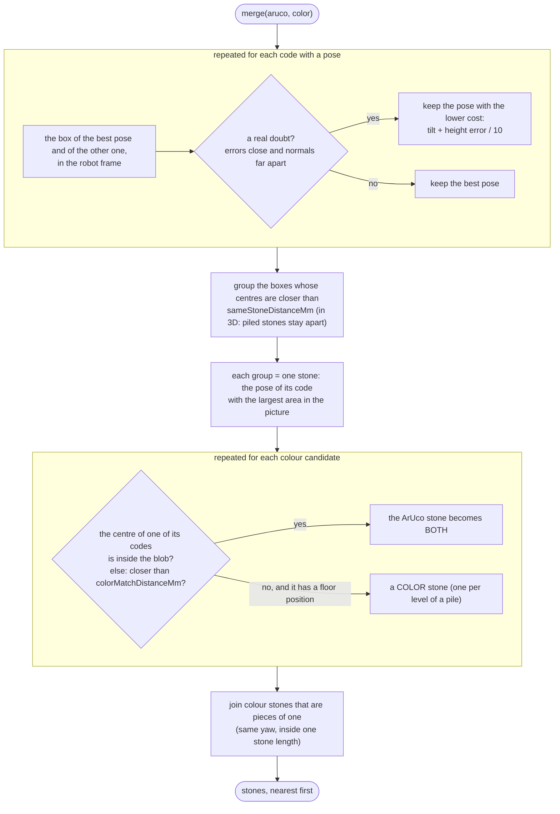

# How the fusion and the black box work

`fusion/stoneFusion.py`, `visionBlackBox.py` and `blackBoxFactory.py`. The only part of the module that knows there are two detectors.

> Checked against the code on 2026-11-23.

## 1. The black box, step by step

`VisionBlackBox.process(FrameInput) -> VisionResult` is the contract. `processWithDetails` returns the same result plus what each detector found, for the apps. The box is built with its parts by `buildVisionBlackBox(config)`, so the box itself never reads files.

It never raises and never waits: tested with empty, grey, 1 x 1, one-channel and noise pictures.

## 2. The fusion

**Why the code with the largest area leads the group** (instead of averaging the faces): a code seen from the side is less precise, and mixing it in made things worse. On 45 synthetic scenes, the median error was 8.6 mm with the mean of the faces and 5.0 mm with the largest code.

**Why pieces are joined:** something covering the middle of a long side splits its blob in two. Each half looked like a stone, so one real stone gave two (the opposite of "never two stones where there is one"). Two colour stones are pieces of one when their yaw differs less than `pieceYawToleranceDeg` and they are closer than `pieceAlongFraction` x 320 mm along the stone and half a width across: two real stones end to end are 320 mm apart and side by side 110 mm, so they are never joined. The joined stone is in the middle of both.

## 3. Confidence

Simple rules, so they can be explained and tuned (`fusion` section of the config):

| Case | Confidence |
|---|---|
| ArUco, clear pose | `arucoConfidence` 0.9 |
| ArUco, the two poses were a real doubt | `ambiguousConfidence` 0.7 |
| Each extra face of the same stone | + `extraFaceBonus` 0.05 |
| The colour agrees (BOTH) | + `colorAgreementBonus` 0.05 |
| Colour alone | score of the blob x `colorConfidenceMax` 0.5 |

Always between 0 and 1.

## 4. Measured on the synthetic demo

The demo video (`apps/syntheticVideoApp.py`, 450 pictures, camera 20 degrees down) through the whole program (`visionApp` → UDP → receiver), compared with the truth of every picture:

| Stone | Centre error (median) | Notes |
|---|---|---|
| Moving and turning | 4.2 mm (90 % under 17 mm) | missing in 17 of 450 pictures (code seen from the side, blob joined with another stone) |
| The same, with its code covered | 90 mm | COLOR in all 90 pictures; the error is along the stone |
| Still, seen at an angle | 10 mm | ARUCO and BOTH |
| Quarry of 2 | 8.5 mm | BOTH since the colour understands piles |

Yaw error: 0.5 degrees median. Stones reported where there was none: 0. Processing: about 11 ms per picture on a Ryzen 5 3600 (86 pictures/s).
