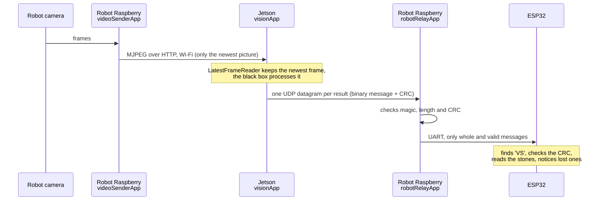
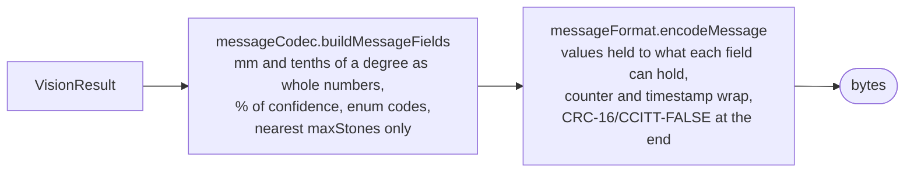

# How the result reaches the robot (and how the video reaches the vision)

`output/`, `apps/visionApp.py`, `apps/link/` and `apps/stream/`.

> Checked against the code on 2026-11-23. Proposal of 2026-11-23 for the radio: Wi-Fi at 5 GHz both ways
> (video to the Jetson, result back to the robot Raspberry, then UART to the ESP32). Not agreed with the team yet.

## 1. The whole chain

**Changing the radio is changing the config, not the code.** The video comes from a URL (`frameSource.streamUrl`). The result goes out by `output.transport`: `udp` (Wi-Fi) or `serial`, which covers a UART or USB cable, a Bluetooth serial port and an ESP-NOW bridge plugged by USB.

## 2. The message

Binary, little-endian, version 1. The byte table for the ESP32 is in `visionMessage.md`. Why binary and not JSON: with 16 stones a message is 145 bytes; at 30 per second that is 4.4 KB/s, a third of what a 115200 baud UART can carry (11.5 KB/s). The same data in JSON would not fit.

- **`messageFormat.py` uses the standard library only**, so the Raspberry can check messages without numpy or OpenCV.
- **Age, not only time:** the Jetson, Raspberry and ESP32 clocks are different, so `timestampMs` alone does not tell the ESP32 how old a result is. `ageMs` is the time from the frame reaching the vision program to the send.
- **Lost messages:** the counter goes up by one per message; a jump says how many were lost.
- **The CRC** is the standard CRC-16/CCITT-FALSE: `123456789` gives `0x29B1` (a test checks it, so the ESP32 code can be checked against the same value).
- **On a serial line** bytes come one after another: `extractMessages` looks for `VS`, waits for the whole message, checks its CRC and, after garbage or a damaged message, looks for the next `VS`. A false `VS` that announces many stones does not hold up the next good message.
- **Reference bytes** are frozen in `tests/vision/output/test_messageFormat.py`: if they change, the robot side breaks, so the version must change instead.

## 3. The programs

| Program | Runs on | What it does |
|---|---|---|
| `apps/visionApp.py` | Jetson (or a PC) | The final program, no screen: images in (`frameSource`), results out (`output`). One summary line every `statsIntervalMs`. Ctrl+C or a system stop end it cleanly |
| `apps/link/robotRelayApp.py` | Robot Raspberry | UDP in, UART out, checking each message. Only Python and pyserial |
| `apps/link/resultReceiverApp.py` | Any computer | Stands in for the ESP32: messages per second, lost, damaged bytes, mean age, nearest stone |
| `apps/stream/videoSenderApp.py` | Robot Raspberry (USB camera) or a PC | MJPEG over HTTP at `http://<host>:<sender.port>/video`, written with plain sockets |

Nothing waits for long: UDP never blocks, a serial write waits at most `serialWriteTimeoutMs` (a USB port whose reader stopped could block forever), opening or reading a stream waits at most `streamTimeoutMs`, and a refused reconnection waits `reconnectDelayMs` before trying again.

## 4. Measured on this computer (2026-11-23)

The whole chain with real processes: `videoSenderApp` (the demo video) → `visionApp` (stream in, UDP out) → `robotRelayApp` → a pseudo-terminal → a fake ESP32 that decodes the bytes.

| Measure | Value |
|---|---|
| Pictures per second through the stream | 30 (the rate of the video) |
| Processing | about 14 ms per picture |
| Messages at the fake ESP32 | 295 of 295, none lost, no damaged byte |
| From the picture arriving at the vision to the ESP32 | 14 ms median, 18 ms for 90 % |

Not measured here: the camera and the Wi-Fi before the Jetson, and a real UART (a 49-byte message takes 4.3 ms at 115200 baud). That needs the hardware.

## 5. Video sender: why the newest picture only

The server (`mjpegServer.py`) keeps one picture and a number that grows with each new one. Each client thread waits until the number changes and sends the newest picture: if the client is slow, the pictures in between are skipped instead of queueing in the network.

On the receiving side, `LatestFrameReader` does the same (see `howVisionWorks.md`, section 5): without it, a slow reader ended up 38 pictures late after 1.6 s.

## 6. What is still open

- The format of the message is a **proposal**: agree it with whoever writes the ESP32 code (team question 1).
- The camera of the robot (Camera Module 3) needs picamera2 or `rpicam-vid` on the Raspberry, not OpenCV: which board sends the video is team question 10 (options in the team notes).
- ROS 2 (team question 11): if chosen, `visionApp` would publish a topic instead of the message; the black box does not change.
