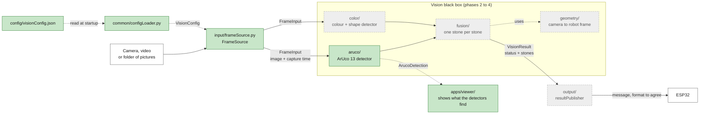
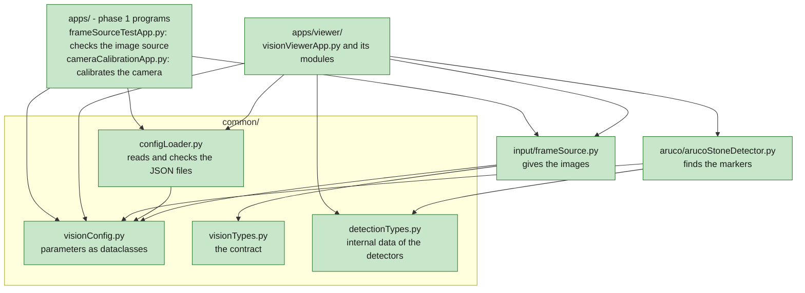
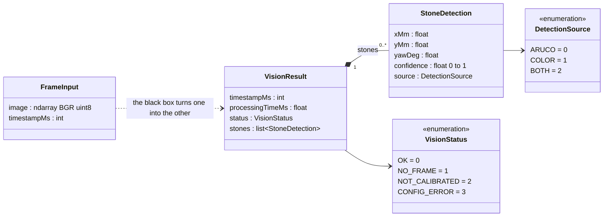
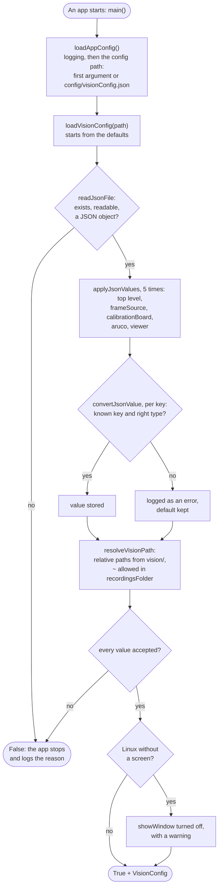
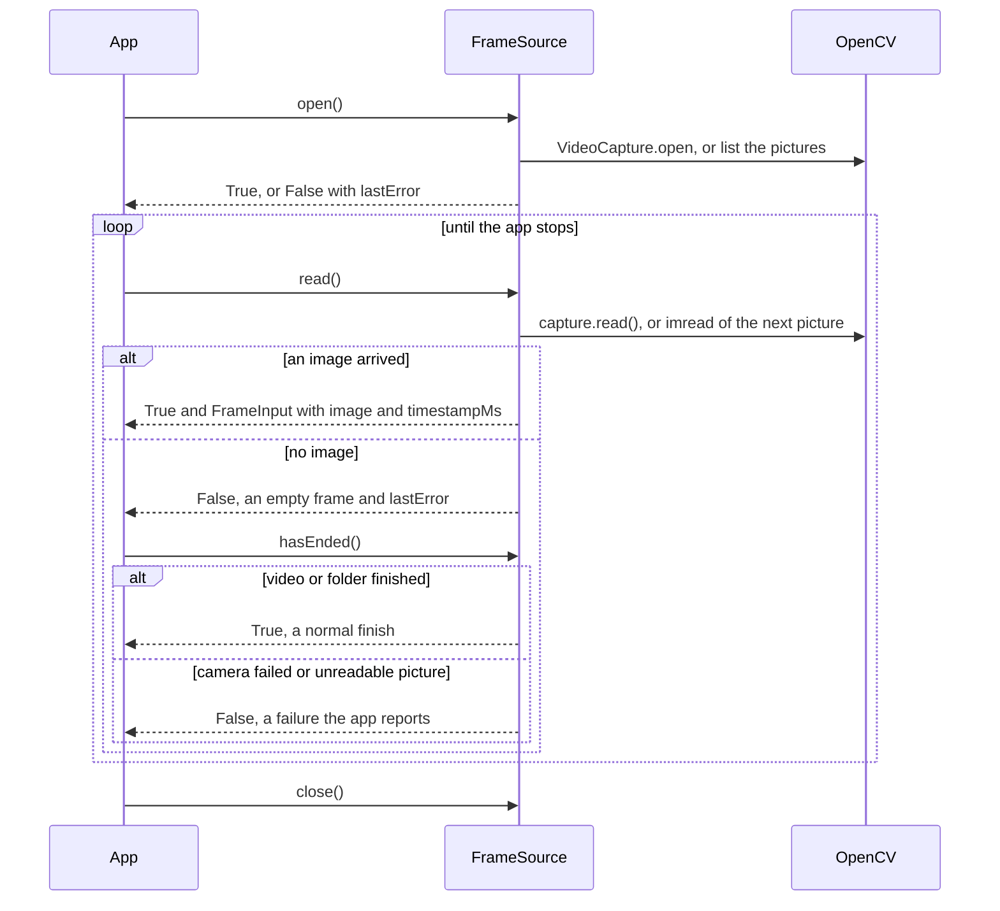
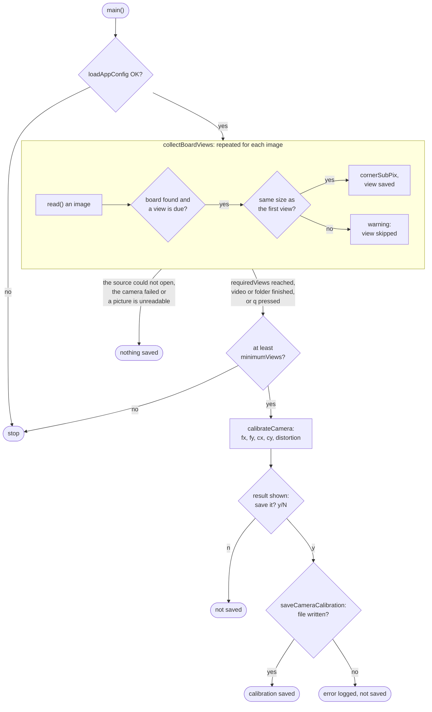
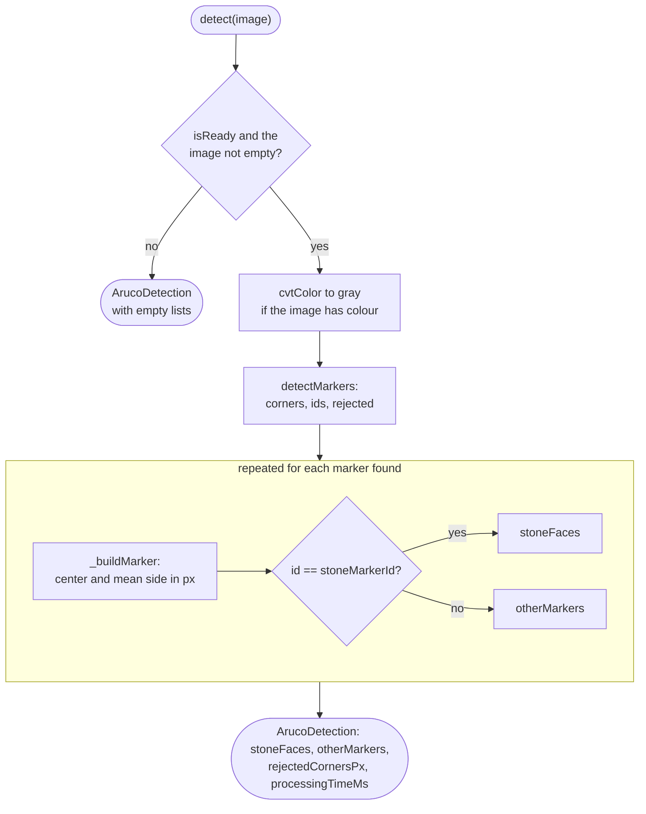
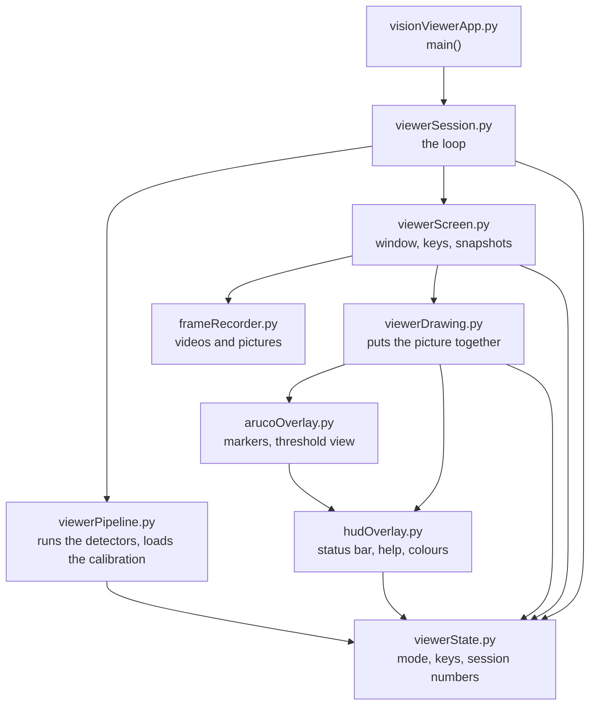

# How the vision subproject works

Diagrams of `src/vision/`, from the big picture to the details.
They are written in [Mermaid](https://mermaid.js.org/): GitHub draws them, and so does VS Code with a Markdown preview that supports Mermaid.

> Checked against the code on 2026-11-17 (end of phase 2a, branch `vision`).
> When `src/vision/` changes, this file changes in the same branch.

**Legend:** green = exists today (phases 1 and 2a) · grey and dashed = planned in a later phase · white = outside the vision code.

## 1. The big picture

One image goes in, one result goes out. The black box never opens the camera and never talks to the robot: `input/` and `output/` do that. The ArUco detector works in pixels (phase 2a); the viewer shows what it finds.

## 2. Who imports whom today

Generated from the code with `pyreverse` and redrawn. The viewer is one box here (its insides are in section 8). Nothing in `common/`, `input/` or `aruco/` imports an app.

## 3. The contract

`common/visionTypes.py`. `VisionResult`, `StoneDetection` and the two enums will reach the ESP32; `FrameInput` stays in Python. The enum numbers are message codes: never renumber, only add at the end.

Positions are in the robot frame: x forward, y left, in mm. `stones` is empty when `status` is not `OK`.

## 4. How the configuration is loaded

`common/configLoader.py`. Every app starts here. A missing key keeps its default; an unknown key or a wrong type stops the app and says which one.

## 5. Reading images

`input/frameSource.py`. The same four methods for a camera, a video or a folder of pictures. When `read()` gives `False`, `hasEnded()` tells a normal finish from a failure.

## 6. The calibration app

`apps/cameraCalibrationApp.py`. A camera or video saves a view every `captureIntervalMs`, so the board can be moved; in a folder every picture is a view. Nothing is saved after a failure or without your confirmation.

## 7. The ArUco detector

`aruco/arucoStoneDetector.py`, phase 2a: everything in pixels. A wrong dictionary name or stone ID is found when the detector is created: `isReady` is `False` and `lastError` says why. It never draws: the viewer does.

## 8. The viewer

`apps/viewer/`, run with `python3 -m vision.apps.viewer.visionViewerApp`. Each file has one job, so none goes over the 6 imports of the team rules. Only `viewerPipeline` knows the detectors and only `viewerDrawing` knows the drawings.

What `ViewerSession.run()` does in each loop, until `q`, `Esc` or the window is closed:

1. If playing, or after `n` while paused: `FrameSource.read()` gives a new image. At the end of a video it pauses on the last one.
2. `ViewerPipeline.process()` runs the detectors of the mode and returns a `ViewerFrame`. While paused the same image is processed again (so a change is seen at once) but counted once.
3. `ViewerScreen.update()` records the raw image if `r` is on, draws, shows, reads a key with `applyKey` and returns `False` to quit.

## How to keep this file right

- Change it in the same branch as the code it describes, and update the date at the top.
- Check the imports of section 2 against the code. From `src/`, with `pylint` installed:
  `pyreverse -o mmd -p vision --source-roots . vision/*/*.py vision/apps/viewer/*.py`
  (the files are listed one by one because the folders have no `__init__.py`).
- Keep to the classic Mermaid diagrams (flowchart, sequence, class): GitHub may not draw the newest syntax.
