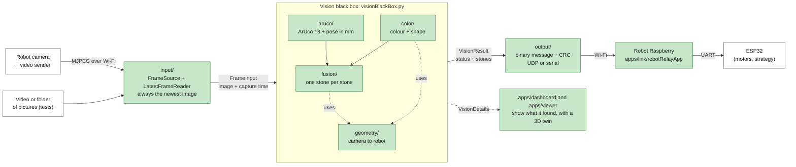
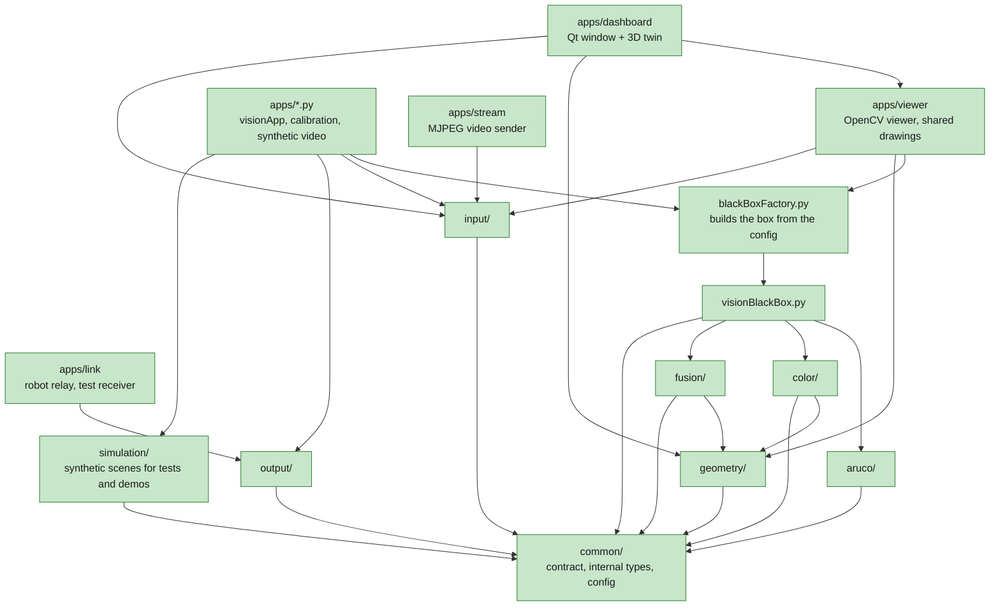
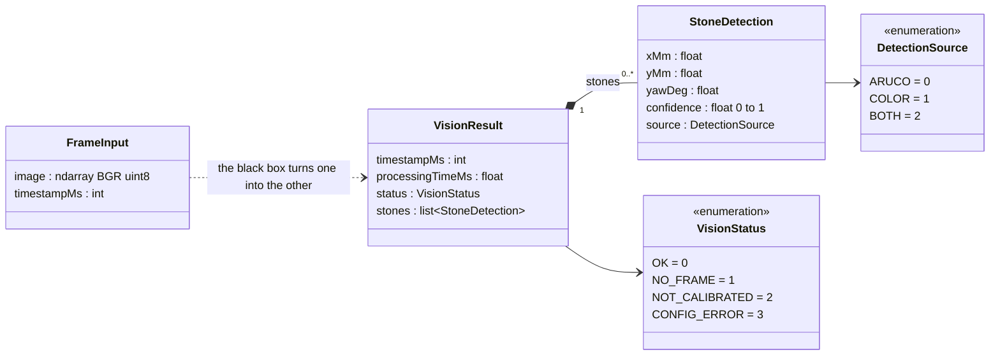
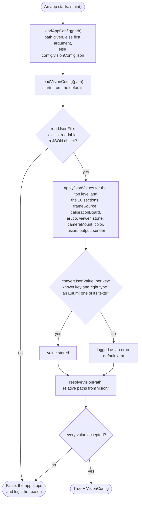
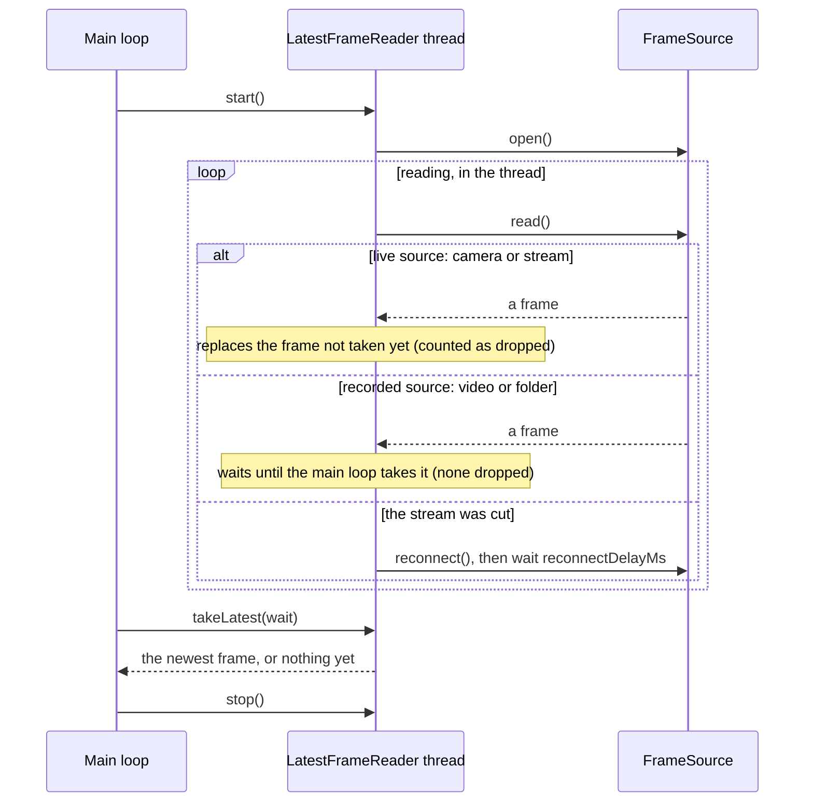
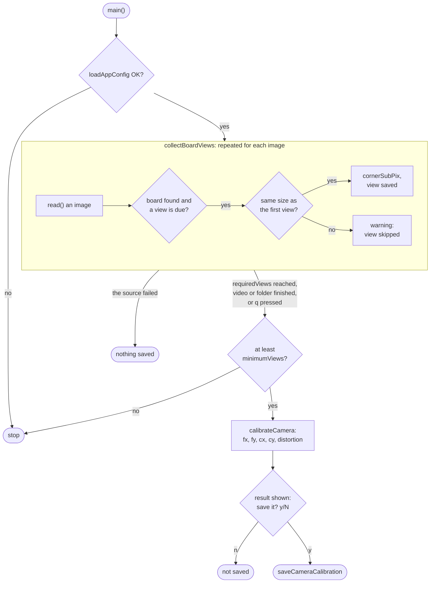

# How the vision subproject works

Diagrams of `src/vision/`, from the big picture to the details.
They are written in [Mermaid](https://mermaid.js.org/): GitHub draws them, and so does VS Code with a Markdown preview that supports Mermaid.

> Checked against the code on 2026-11-23 (phases 1 to 5 done, phase 6 without hardware, branch `vision`).
> When `src/vision/` changes, these files change in the same branch.

**The other files of this folder:**

| File | What it explains |
|---|---|
| `howDetectionWorks.md` | The two detectors: ArUco with its pose in mm, and colour + shape |
| `howFusionWorks.md` | How both detectors become one list of stones, and the black box |
| `howOutputWorks.md` | The message to the robot, the transports, the video stream and the relay of the Raspberry |
| `visionMessage.md` | The byte table of the message, for whoever writes the ESP32 side |
| `howDashboardWorks.md` | The dashboard (Qt, with the 3D twin) and the OpenCV viewer |

**Legend:** green = exists today · white = outside the vision code (hardware, other subprojects).

## 1. The big picture

One image goes in, one result goes out. The black box never opens the camera and never talks to the robot: `input/` and `output/` do that.
Since 2026-11-18 the images are processed on a Jetson on the central platform: the camera of the robot sends them over Wi-Fi, and the result goes back the same way.

## 2. Who imports whom (by folder)

Made from the imports of the code (a script reads every `from vision...` line). An arrow means "uses". No detector imports an app, and `apps/link/` only needs `output/messageFormat.py`, which uses the standard library only: the robot Raspberry runs it with Python and pyserial, without numpy or OpenCV.

## 3. The contract

`common/visionTypes.py`, unchanged since phase 1. `VisionResult`, `StoneDetection` and the two enums reach the ESP32 in the message (`visionMessage.md`); `FrameInput` stays in Python. The enum numbers are message codes: never renumber, only add at the end (a test freezes them).

What each field means since phases 2b to 4 (in the robot frame: x forward, y left, origin on the floor under the robot, mm):

| Field | Meaning |
|---|---|
| `xMm`, `yMm` | Centre of the stone seen from above. A pile gives one stone per level, with the same x and y (team question 7) |
| `yawDeg` | Angle of the 320 mm side from the robot x axis, to the left, in [-90, 90): a stone turned 180 degrees is the same stone. A standing stone has no long side on the floor: the angle of a short side is given (team question 6) |
| `confidence` | ArUco 0.9 (0.7 if its pose was a doubt), +0.05 per extra face and +0.05 if the colour agrees; colour alone at most 0.5 |
| `stones` | Nearest first. Empty unless the status is `OK` |

`NOT_CALIBRATED` now also covers a camera mount that nobody has measured (`cameraMount.isMeasured` false): made-up positions never reach the robot.

## 4. How the configuration is loaded

`common/configLoader.py`. A missing key keeps its default; an unknown key or a wrong type stops the app and says which one. Since phase 3 the sections are split in three files: `visionConfig.py` (frame source, calibration board, ArUco, viewer and the whole `VisionConfig`), `detectionConfig.py` (stone, camera mount, colour, fusion) and `outputConfig.py` (output, video sender). Any `Enum` is written in the JSON as its text (`"mode": "stream"`, `"transport": "udp"`).

The dashboard writes back too: `saveConfigSection` replaces only the colour range and keeps the rest of the file; `saveVisionConfig` writes a whole config (the synthetic demo uses it).

## 5. Reading images

`input/frameSource.py` gives one image at a time from a camera, a video, a folder or a **stream** (a URL, opened with a time limit so a dead sender never blocks). `input/latestFrameReader.py` reads it in a thread:

Why: measured on 2026-11-23 with the MJPEG sender on this computer, a reader that takes one image every 200 ms straight from the stream ends up 38 images (1.3 s) late after 1.6 s, and the delay keeps growing. With `LatestFrameReader` the delay stayed at 0 images.

## 6. The calibration app

`apps/cameraCalibrationApp.py`, unchanged since phase 1. A camera or video saves a view every `captureIntervalMs`, so the board can be moved; in a folder every picture is a view. Nothing is saved after a failure or without your confirmation.

## 7. How it was tested (without any real stone)

There is no box, printed code or calibrated camera yet, so everything is tested on **synthetic scenes** (`simulation/`): a pinhole camera with its own look-at maths (it does not use `geometry/`, so a sign error cannot hide in both), stones drawn face by face with a depth buffer, JPEG, noise, blur and lens distortion. `pytest ../tests/vision` runs 81 tests; the main numbers are in each file of this folder. What only the real hardware can tell is listed in the team notes (calibration at the stream resolution, the real code size, the camera mount, the brown of the real mat, motion blur, Wi-Fi delay).

## How to keep these files right

- Change them in the same branch as the code they describe, and update the date at the top.
- Check the imports of section 2 against the code (the folders have no `__init__.py`, so list the files): from `src/`, `pyreverse -o mmd -p vision --source-roots . vision/*.py vision/*/*.py vision/apps/*/*.py`.
- Keep to the classic Mermaid diagrams (flowchart, sequence, class): GitHub may not draw the newest syntax.
